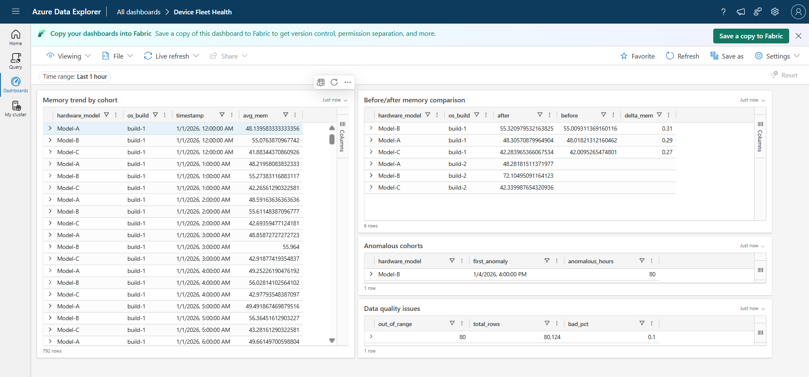
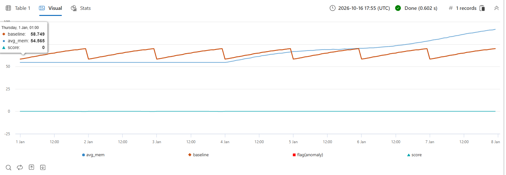
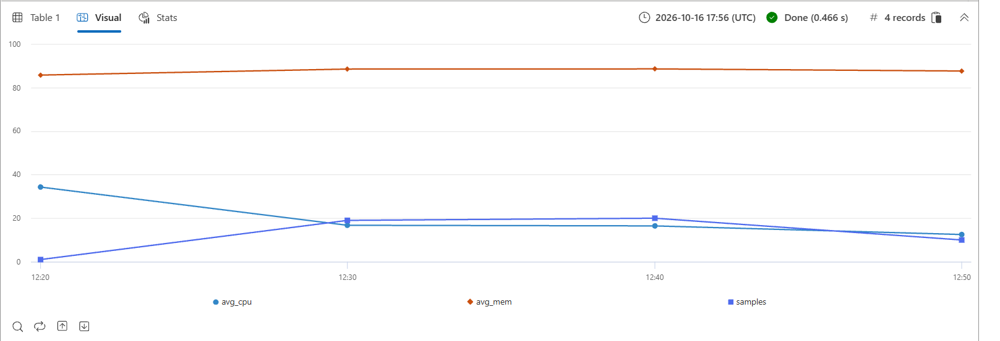

# Device Telemetry Analytics Platform

A small-scale version of a device-health telemetry pipeline: collect metrics from a
fleet of devices, store them in Azure Data Explorer, and use KQL to detect regressions
and anomalies by cohort.

> **Status:** Core pipeline complete (generator, collector, ADX ingestion, KQL analysis, dashboard).

## Scenario
A new OS build (`build-2`) rolls out to half the fleet on day 3. After rollout:
- **Model-B + build-2:** memory leaks slowly (~0.35% per hour).
- **Model-C + build-2:** battery drains ~2x faster.

The pipeline should answer: *Is something abnormal? Who is affected? When did it start and how bad is it?*

## Architecture
```
generate_fleet.py / collector.py  ->  ingest.py  ->  Azure Data Explorer  ->  KQL  ->  Dashboard
 (simulated fleet + real psutil)     (CSV/Kusto)       (DeviceTelemetry)     (anomalies, cohorts)
```

## Data schema
`timestamp, device_id, os_build, hardware_model, region, cpu_pct, mem_pct, battery_pct`

## Quick start
```bash
pip install -r requirements.txt

# 1. Synthetic fleet with injected regressions + data-quality faults
python generate_fleet.py --devices 40 --days 7 --seed 42 --out data/fleet_telemetry.csv

# 2. Real telemetry from your own machine (leave running for a while)
python collector.py --interval 30 --out data/local_telemetry.csv

# 3. Create the table in ADX (kql/00_setup.kql), then ingest
python ingest.py data/fleet_telemetry.csv data/local_telemetry.csv
```
The generator also writes `data/ground_truth.json` (which devices carry which regression,
rollout time, and counts of injected data-quality faults) so detection can be validated.

## KQL queries
| File | Purpose |
|---|---|
| `kql/00_setup.kql` | Create the table |
| `kql/01_data_quality.kql` | Duplicates, out-of-range values, missing heartbeats |
| `kql/02_trends_and_cohorts.kql` | Trends, percentiles, top-N by cohort |
| `kql/03_regression_before_after.kql` | Build-2 vs build-1 comparison after rollout, battery drain, leak slope |
| `kql/04_anomaly_detection.kql` | `series_decompose_anomalies` and z-score baseline |
| `kql/05_local_machine.kql` | Real telemetry from the local machine |

## Findings
All results below come from running the queries in `kql/` on the simulated fleet (40 devices, 7 days, 5-minute samples).
Build-1 devices during the same post-rollout window act as the control group.

**1. Memory regression on Model-B / build-2** (`kql/03`, query 1)

| Hardware model | build-1 (control) | build-2 | Change |
|---|---|---|---|
| Model-B | 55.3% | 72.1% | **+16.8 pts** |
| Model-A | 48.3% | 48.3% | ~0 |
| Model-C | 42.3% | 42.3% | ~0 |

The injected leak rate was 0.35%/hour; averaged over the 4 post-rollout days that predicts about +16.8 points, which matches the measurement.

**2. Battery-drain regression on Model-C / build-2** (`kql/03`, query 2)

| Hardware model | build-1 (%/hr) | build-2 (%/hr) | Ratio |
|---|---|---|---|
| Model-C | 4.99 | 10.00 | **2.0x** |
| Model-A | 5.94 | 6.03 | ~1.0x |
| Model-B | 6.98 | 7.01 | ~1.0x |

**3. Anomaly detection** (`kql/04`, query 1)
`series_decompose_anomalies` was trained on the pre-rollout period and scored on the 96 hours after it. Only **Model-B** was flagged:
first anomaly at 2026-01-04 16:00 (about 16 hours after rollout), 80 anomalous hours out of 96. Model-A and Model-C were not flagged.
Scoring the whole series without a training window flagged nothing, because the function absorbed the slow ramp into its trend.

**4. Data quality** (`kql/01`)
The generator injects dropped heartbeats, duplicate rows and out-of-range values (counts in `data/ground_truth.json`).
Out-of-range rows are about 0.1% of the data; all queries remove them and de-duplicate on (device, timestamp) before analysis.

**5. Real telemetry** (`kql/05`)
`collector.py` samples CPU, memory and battery from a real Windows 11 laptop, ingested into the same table as a separate `Local-Machine` cohort.





## Limitations
- Fleet data is simulated; real device telemetry is noisier.
- `psutil` battery data is unavailable on machines without a battery.
- At scale: stream via Event Hubs, add retention policies, tune anomaly thresholds.
- The anomaly detector uses the known rollout time to split training from test data. In production the split would come from deployment metadata or a rolling baseline.
- Detection is at hardware-model level; only about half of each model is on build-2, so the leak is diluted in the model-wide average.